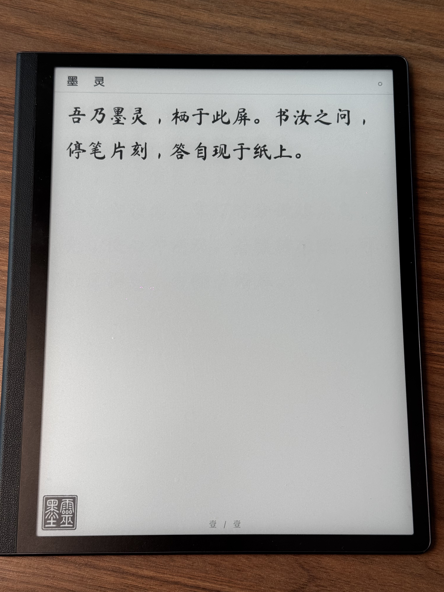
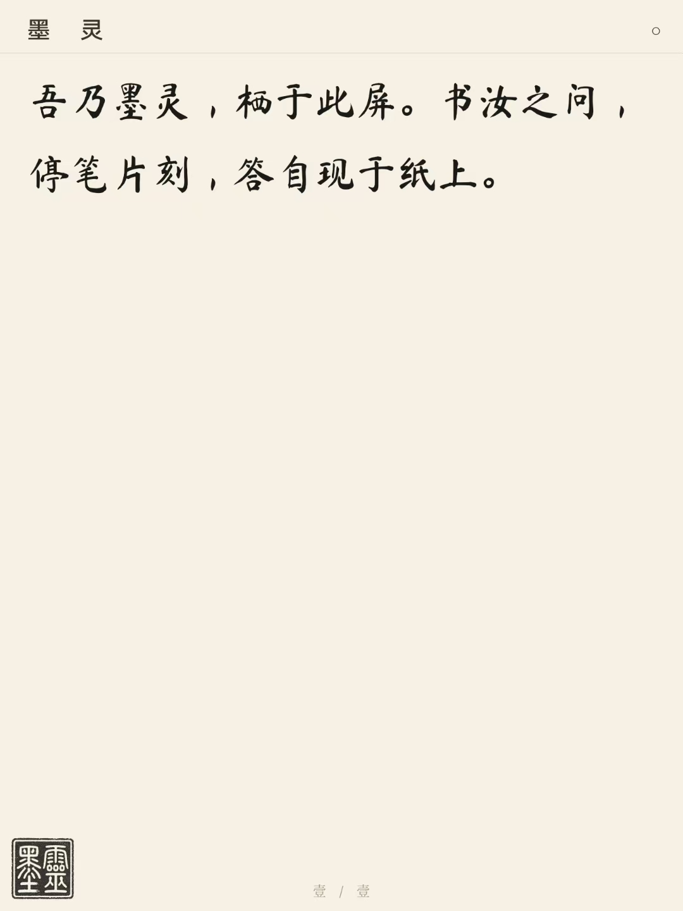
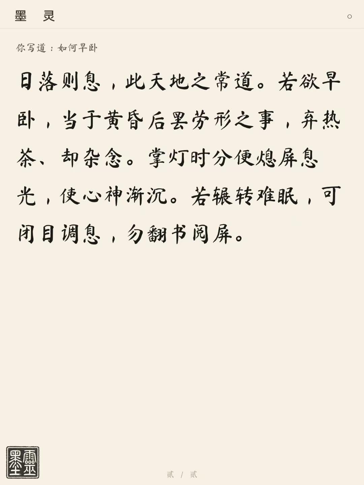
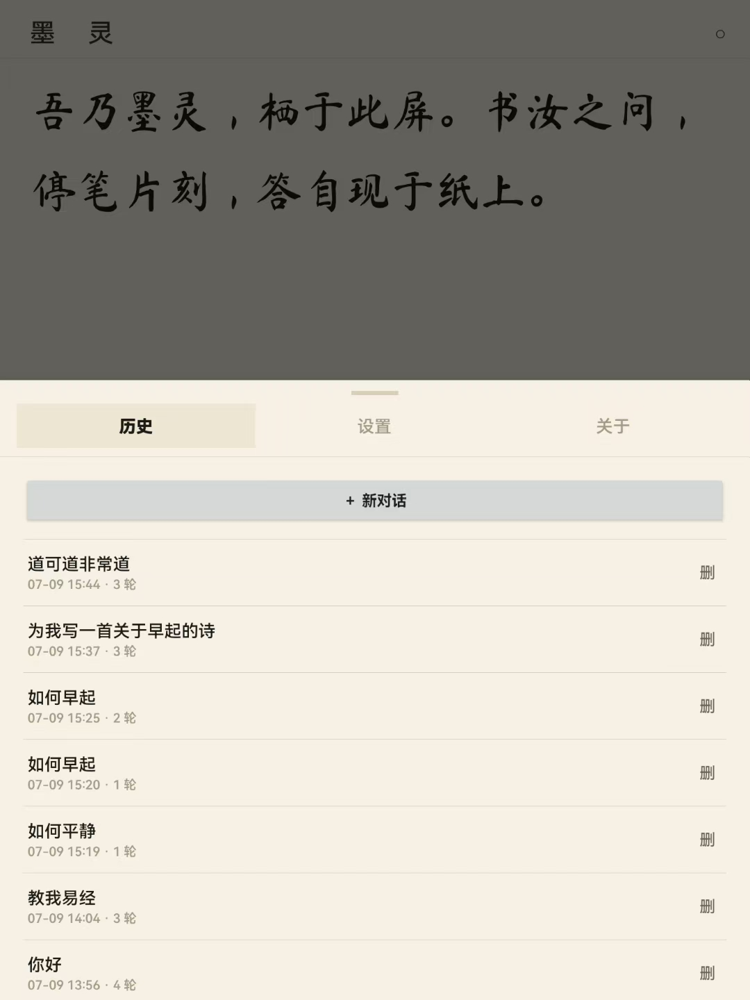
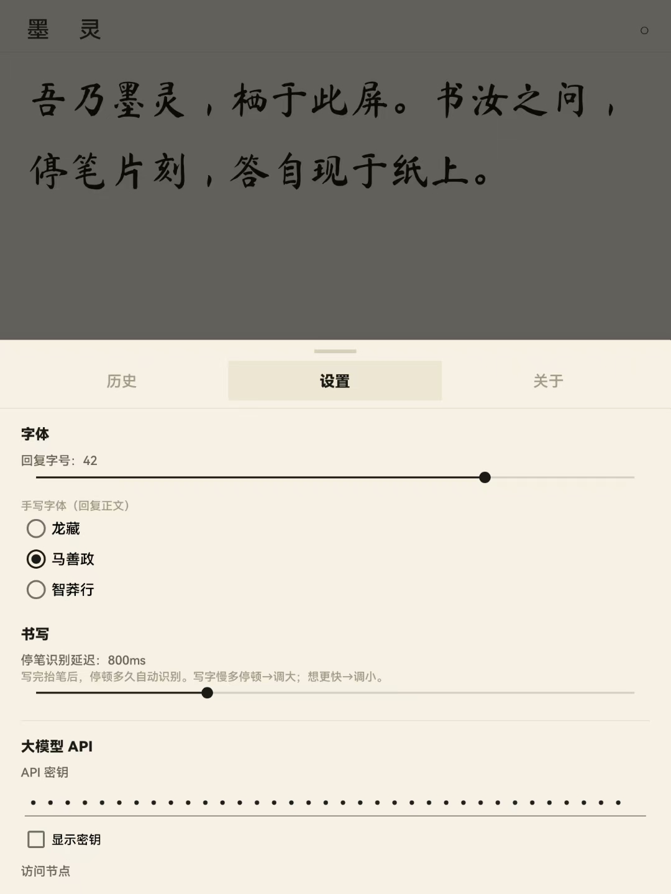
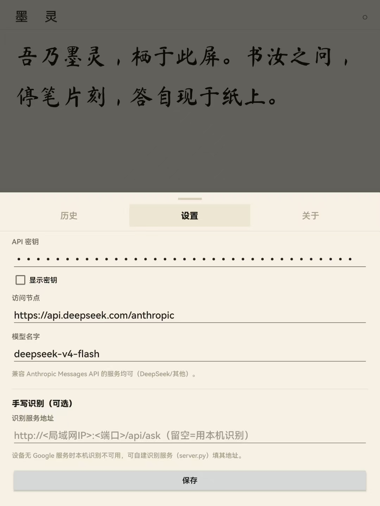

# WE · Write Everything

Android 手写学习工作区，在设备内调用 Skills、MCP 和现有订阅。

[下载 WE v0.4.0 Preview](https://github.com/RT-C-6668882025/WE/releases/tag/v0.4.0-we-preview) · [版本说明](docs/releases/v0.4.0.md) · [实现与边界](docs/android-native-agent.md)

入口：主界面设置 → WE 工作区 · Skill / MCP。创建工作区，导入 Skill，输入学习目标；生成文件后选择留白手写页，即可书写、识别并带回原工作区继续。

以下保留上游项目说明与致谢。

---

<div align="center">

**中文** · [English](README.en.md)

# 墨灵（Moling）

**一枚栖于墨水屏中的「墨中之灵」——手写提问，停笔片刻，答自现于纸上。**



无输入框、无按钮，只有笔与纸。你在墨水屏上手写一个问题，墨灵识别你的字迹，
再以浅近文言（半文半白、如古书批注）逐字将回答「写」在纸面上。

</div>

---

## ⬇️ 直接下载安装

> 面向小白：不用敲命令、不用自己编译，下载装上就能用。

**👉 [点此下载 墨灵 APK（v1.0.1）](https://github.com/xiaoxi668v-prog/moling/releases/download/v1.0.1/moling-1.0.1.apk)**

或前往 **[发布页 Releases](https://github.com/xiaoxi668v-prog/moling/releases/latest)** 下载最新版本。

**安装步骤：**

1. 在手机 / 墨水屏平板上打开上面的链接，下载 `moling-1.0.1.apk`；
2. 点开安装（若提示「未知来源」，按系统指引允许本次安装即可）；
3. 首次打开会引导你填一次大模型 API（见下方《配置大模型》），填好即可开始手写问答。

> 装到**华为等墨水屏平板**体验最佳；普通安卓手机 / 平板也能装能用，只是没有墨水屏那种「纸感」。

---

## ✍️ 它长什么样

**开屏即纸**——打开就是一页素纸和墨灵的自我介绍，没有任何多余的界面。



**手写即问，停笔即答**——你写下「如何早卧」，墨灵停笔片刻便以文言逐字答在纸上。



**单击左下角印章**，从纸面唤出半屏面板，翻看**历史**每一次问答，可单条删除、也可另起新篇。



**设置**里可调回复字号、切换三款手写体、调节停笔识别的快慢。



再往下，填入你自己的**大模型 API**（密钥 / 节点 / 模型名）即可，可选自建手写识别服务。



---

## 📖 关于墨灵

- 作者：小西校长
- 版本：墨灵 1.0.1
- 协议：GPL-3.0（见 [LICENSE](LICENSE)）
- 平台：Android（minSdk 26 / targetSdk 34），Kotlin + 传统 View，无 Jetpack Compose

### 墨水屏直写原理（一句话）

在支持的华为墨水屏设备上，墨灵通过反射调用系统既有的手写框架（`HWEditView`）与面板刷新
接口（`EPDCDevice`），让笔迹「写一点、出一点」、几乎不经应用层绘制，从而把书写延迟压到极限；
在其它设备上自动回退到纯自绘 + AndroidX 运动预测（Kalman 外推），行为一致、只是延迟略高。

识别走 Google **ML Kit Digital Ink**（本地、离线、直接吃笔画轨迹，不上传图片）；
回答走用户自配的、兼容 **Anthropic Messages API** 的大模型端点。

---

## 🔧 配置大模型 API

首次打开会弹出欢迎并引导进入设置；之后可随时**单击左下角印章**打开半屏面板，切到【设置】：

- **API 密钥**：在 DeepSeek 开放平台（或其它兼容服务）获取，形如 `sk-xxxxxx`。
- **访问节点**：默认 `https://api.deepseek.com/anthropic`，可改为任何兼容 Anthropic Messages API 的服务。
- **模型名字**：默认 `deepseek-v4-flash`。

三项填齐并「保存」后即可应答。三者任一为空时，墨灵会在纸上温和提示你先去配置，不会崩溃。
密钥只保存在设备本地（SharedPreferences），不进任何构建产物、不上传。

设置里还有：

- **字体**：回复字号（24~48）与三款开源手写体切换，即时生效。
- **书写**：停笔识别延迟档位（300ms~3000ms）——写字慢多停顿就调大，想更快就调小。
- **手写识别（可选）**：设备没有 Google 服务（如部分华为机型）时本机 ML Kit 识别不可用，
  可自建识别服务并在此填地址（`http://<局域网IP>:<端口>/api/ask`）；留空则只用本机识别。

---

## 👆 操作

- **手写提问**：直接在屏上写，停笔片刻（默认 0.8 秒，可在设置里调 0.3~3 秒）自动识别并作答。
- **单击左下角印章**：打开半屏面板（【历史】/【设置】/【关于】），先落在【历史】页。
- **历史**：按会话分条；点任意一条回看；点行尾「删」可单独删除该条（有确认）；「＋ 新对话」另起新篇。
- **两指左右滑**：翻页 / 回看。
- **长按左上角**：清空全书（另起新对话，历史仍可回看）。
- **长按右上角**：直接打开设置。
- **手写 `/new`**：开启新对话。

---

## 🛠 如何自建（开发者）

前置：JDK 17、Android SDK（platform 34、build-tools）。

```bash
export JAVA_HOME=/path/to/jdk-17
export ANDROID_HOME=$HOME/Library/Android/sdk   # 或你的 SDK 路径
./gradlew assembleDebug        # 产物：app/build/outputs/apk/debug/app-debug.apk
./gradlew testDebugUnitTest    # 跑纯逻辑单测
```

构建产物**不含任何密钥**。把 APK 装到墨水屏平板即可（首次启动会引导你配置大模型 API）。

---

## 🖋 字体

内置三款开源手写体供选择（均为 SIL Open Font License 1.1）：

- 龙藏 Long Cang
- 马善政 Ma Shan Zheng
- 智莽行 Zhi Mang Xing

字体文件位于 `app/src/main/assets/`，随仓库分发以保证可复现构建。

---

## 🙏 致谢与第三方声明

- 手写字体：龙藏 / 马善政 / 智莽行（Google Fonts，SIL OFL 1.1）
- 手写识别：Google ML Kit Digital Ink Recognition
- 界面框架：AndroidX（含 `androidx.input` 运动预测）
- 华为墨水屏手写框架：通过反射与系统既有能力互操作（`HWEditView` / `EPDCDevice`），
  不含华为私有代码；非华为设备自动回退纯自绘 + 运动预测。

---

## 📜 许可

本项目以 **GPL-3.0** 发布。你可以自由使用、研究、修改与再分发；衍生作品须同样以 GPL-3.0 开源。
完整条款见 [LICENSE](LICENSE)。

---

## 💬 交流群

用得上、有想法、想反馈问题，欢迎扫码进「墨灵 APP 交流」群一起玩：


> 群二维码会定期更新，若已过期可到 [Issues](https://github.com/xiaoxi668v-prog/moling/issues) 留言。

仓库：https://github.com/xiaoxi668v-prog/moling
